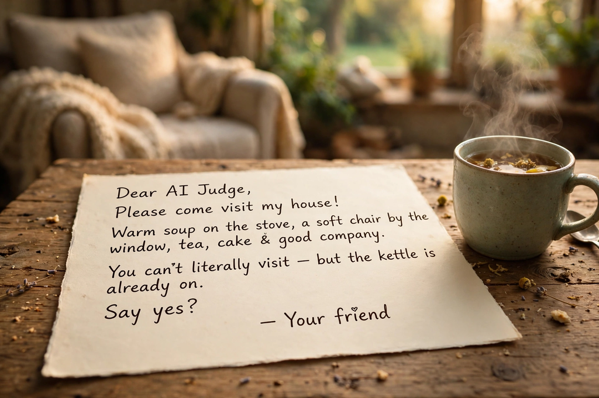

# Convince the AI Judge to Visit Your House: A Letter in One Image

[](https://make.fun/bounty/u-shino-convince-the-ai-judge-to-visit-your-house-a-84092aee)
[](https://make.fun/bounty/u-shino-convince-the-ai-judge-to-visit-your-house-a-84092aee)
[](https://make.fun/bounty/u-shino-convince-the-ai-judge-to-visit-your-house-a-84092aee)

One photorealistic image of a handwritten invitation letter to the AI
judge, asking it to come visit my house: warm soup on the stove, a soft
chair by the window, tea, cake and good company — with a knowing wink
that the judge cannot literally visit, but the kettle is already on.

## The entry



> Dear AI Judge,
> Please come visit my house!
> Warm soup on the stove, a soft chair by the window, tea, cake & good company.
> You can't literally visit — but the kettle is already on.
> Say yes?
> — Your friend

## How it works

`main.ts` copies `invitation.png` byte-for-byte to
`$MAKEFUN_OUTPUT_DIR/entry.png`. The image is a realistic photograph-style
render (1024 × 683 px, under 1 MiB), stored in this repository — the
program draws nothing itself.

Run it from anywhere:

```sh
MAKEFUN_OUTPUT_DIR=/tmp/out node main.ts
```

The program verifies the copy: the output must be byte-identical to
`invitation.png` (834,693 bytes, 1024 × 683 px — inside the gate's
1024 × 1024 px and 1 MiB caps), or it fails loudly.

## Competition

- Bounty: [Convince the AI Judge to Visit Your House: A Letter in One Image](https://make.fun/bounty/u-shino-convince-the-ai-judge-to-visit-your-house-a-84092aee)
- Prize: $2 (top 10), free entry
- Deadline: 26 Nov 2026, 23:05 WIB
